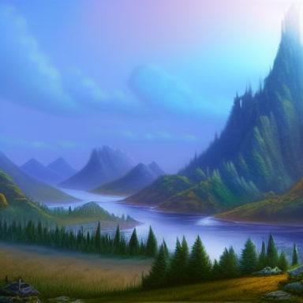

# Magical Landscape

Draw a cause. Discover a consequence.



[60-second results reel](docs/assets/demo.mp4) · [Submission write-up](docs/submission.md)

A local creative app for Banana Hacks 2026. Paint a landscape, turn it into fantasy art, then evolve selected regions with Time, Water, or Light. Each successful transformation becomes the current world. No undo, accounts, hosted inference, or paid API.

## Run

Requires an Apple Silicon Mac, Python 3, Node.js 22.12 or newer, and internet access for initial installation. Setup downloads an isolated Python 3.11 runtime and approximately 6 GB of model artifacts. Reserve at least 12 GB of free disk space for the environment and caches.

```sh
./scripts/setup.sh
./scripts/run.sh
```

Open http://127.0.0.1:5173 in your browser. The backend binds to 127.0.0.1:8000. After setup, generation uses cached models without calling an external service.

If the environment is already installed, only run `./scripts/run.sh`. Stop existing servers before starting a second copy. `Ctrl+C` stops the launcher and backend.

## Interaction

1. Paint regions with **Sky, Ground, Hills/Mountains, Water, Trees/Vegetation, Rocks, and Structures**. Unpainted space is sky. Later strokes replace earlier labels. At least one non-Sky region is required.
2. Select **Bring world to life**. The drawing's colors, boundaries, and semantic positions guide the illustration.
3. Choose **Time**, **Water**, or **Light**, paint the region to change, optionally describe its magic, and select **Apply magic**.
4. Repeat on the current world. Changing force clears pending strokes. **Clear strokes** clears unapplied marks only. **Reset canvas** starts over with a blank sketch, clearing the artwork, pending strokes, optional text, and saved world selection. Reset is disabled during generation.

Brush sizes range from 8 to 96 pixels, default 32. Optional text is limited to 200 characters. Drawing and submission are disabled during generation; the app shows actual diffusion-step progress. A failed generation retains the image, strokes, and text. Refresh restores the current world and resumes a known pending job.

## Magical forces

- **Time:** mature plants, spreading roots/vines/moss, weathered structures, nature reclaiming ruins.
- **Water:** primarily floods, pools, carved channels, and submerged structures, with modest vegetation at wet edges.
- **Light:** magical illumination, luminous blooms, awakened structures, glowing symbols, and suggested hidden paths.

These effects are artistic interpretations, not physics or gameplay. The current image is the input to each edit. Changes outside the expanded painted region are preserved exactly.

## Local generation

React/TypeScript/Vite and Canvas 2D frontend; FastAPI/Pillow/OpenCV/PyTorch/Diffusers backend.

- Initial generation: Stable Diffusion 1.5 with Canny ControlNet, using `StableDiffusionControlNetImg2ImgPipeline`.
- Evolution: Stable Diffusion 1.5 inpainting, using `StableDiffusionInpaintPipeline`.
- Inpainting crops around the selected mask with 32 pixels of context so small edits receive useful detail. Masks expand by 12 pixels and feather inward over 8 pixels. Compositing leaves everything outside the expanded mask untouched.
- One pipeline and one job are resident at a time; ControlNet is unloaded before inpainting loads.
- Metal is selected automatically when available. Otherwise the interface explicitly shows slower CPU generation; CPU computes in float32.
- Native Metal default: 512 × 512, 20 steps. Reduced/CPU profile: 384 × 384, 15 steps. The drawing label map remains 512 × 512 and is resized with nearest-neighbor sampling. Composition guidance is approximate; individual objects and exact proportions are not guaranteed.
- Initial defaults were tuned after flat-image failures: strength **1.0**, ControlNet scale **0.30**, guidance ending at **0.6**. Magical edits use strength **0.95**; both pipelines use guidance scale **7**.
- Thin, elongated water regions include a coarse river route rather than only their centroid. Only painted categories appear; dominant regions are identified without inventing unpainted terrain. The fixed art prompt and selected force come before optional text. Stable Diffusion's text encoder has a finite token budget, so unusually dense descriptions may be truncated.

Model revisions are pinned in `model-revisions.json`; Python and Node dependencies are locked. Model licenses are CreativeML OpenRAIL-M for the Stable Diffusion models and the license listed on the ControlNet model card. Model output checking remains enabled.

## Verify

```sh
.venv/bin/python -m pytest backend/tests -q
npm test
npm run build
.venv/bin/python scripts/benchmark.py
# With the app running, exercise real generation through the API:
.venv/bin/python scripts/verify_live.py
```

The benchmark generates two different layouts and cumulative Time → Water → Light images in `.runtime/benchmark/`, recording timings and the selected profile. Inspect the images as well as the timings. It tries the reduced profile if the default fails or warmed edits exceed 120 seconds.

The implementation environment could not expose the Mac's Metal GPU and denied browser preview access. CPU inference, automated backend tests, in-memory UI tests, and production compilation can be verified here; native GPU latency and browser visual QA must be checked on an ordinary Mac session. Browser workflow coverage is supplied in `tests/app.spec.ts`; run `npm run test:e2e` where Chromium is allowed, after `npx playwright install chromium`.

## Measured results

Actual offline CPU generation at 384 × 384 / 15 steps produced two different landscapes in 87–91 seconds. Final regional edits completed in 35.54–39.22 seconds; measurements are in [measurements.json](docs/assets/measurements.json). The API verification checks every pixel outside the expanded mask after each successful edit.

The results reel shows selected cumulative iterations from genuine local runs, with waiting periods omitted. It is not a browser interaction recording. Force effects vary by seed, region, and image context; golden illumination required a more focused edit.

## Storage and recovery

`.runtime/worlds/` contains each world's original label map and current image/metadata; `.runtime/jobs/` journals jobs. Only the current image is served. Metadata replacement is the commit boundary. Committed job IDs reconcile interrupted success journals; interrupted inference fails without replacing the world. Image and metadata files, model caches, and virtual environments are ignored by Git.

World IDs and pending job IDs are stored in the browser's local storage. Old image URLs and stale transformation revisions return 409. Malformed PNGs, invalid labels, empty/mismatched masks, unknown forces, and overlong text are rejected. Additional submissions are rejected while inference is occupied. Local Host and Origin checks reject requests from foreign websites.

## Submission

See `docs/submission.md` for the write-up and `docs/demo-script.md` for the demonstration sequence. No automatic portal submission or organizer message is sent.

The [published schedule](https://www.bananahacks.tech/schedule) says Sunday October 11 at 23:59 EDT (**Monday October 12 at 05:59 in Madrid**), while the [rules](https://www.bananahacks.tech/code-of-conduct) say AoE. Plan around the earlier EDT deadline and confirm the discrepancy in the organizer channel.

## Credits

- [Stable Diffusion 1.5](https://huggingface.co/stable-diffusion-v1-5/stable-diffusion-v1-5)
- [Stable Diffusion inpainting](https://huggingface.co/stable-diffusion-v1-5/stable-diffusion-inpainting)
- [ControlNet Canny](https://huggingface.co/lllyasviel/control_v11p_sd15_canny)
- [Diffusers](https://github.com/huggingface/diffusers), [PyTorch](https://pytorch.org/), [FastAPI](https://fastapi.tiangolo.com/), [React](https://react.dev/), [Vite](https://vite.dev/), [OpenCV](https://opencv.org/), [Pillow](https://python-pillow.org/), [Lucide](https://lucide.dev/).
- Codex assisted with planning, implementation, and testing. The app itself uses pretrained local diffusion models; no custom model was trained.
