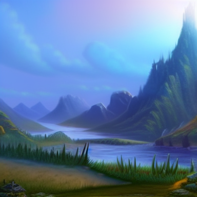
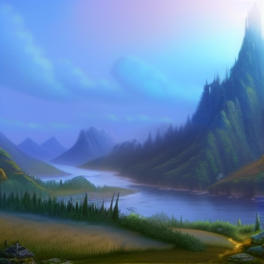
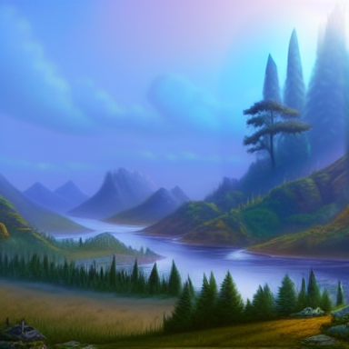
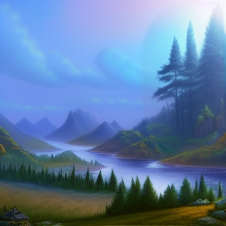
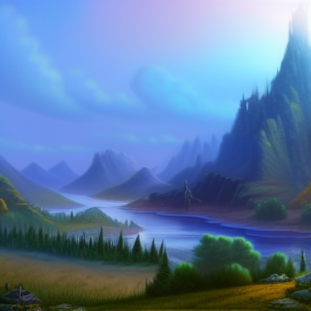
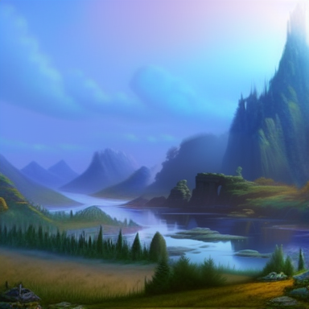
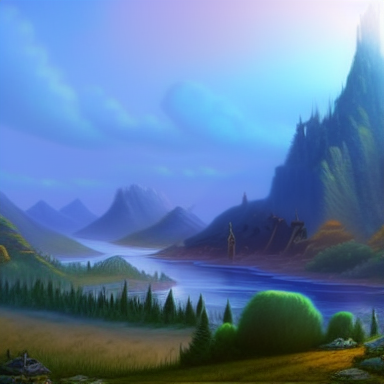
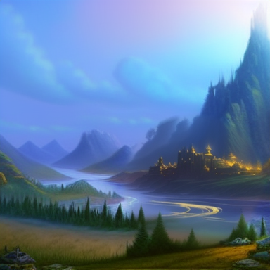

# Force-edit model comparison

The app now uses [DreamShaper 8 Inpainting](https://huggingface.co/Lykon/dreamshaper-8-inpainting) for Time, Water, and Light. Initial labeled landscape generation remains Stable Diffusion 1.5 plus Canny ControlNet.

## Comparison conditions

The same [public test landscape](assets/world-a.png), masks, empty optional text, and seed 1885687707 were used for each model. Each edit starts from the original landscape, rather than the previous comparison output. This is a small visual benchmark, not a comprehensive model evaluation.

Both completed models ran offline on CPU at 384 × 384 with float32 computation, DPM-Solver++, guidance 7, and the app's force prompts. Time used strength 0.85, 64 pixels of crop context, 15 effective denoising steps, and its upward-expanded mask. Water/Light used strength 0.95, 32 pixels of context, and 14 effective steps. Safety checking remained enabled. Exact pixel equality outside each blend mask passed for all completed edits.

## Results

| Region / effect | Previous SD 1.5 | DreamShaper 8 |
|---|---|---|
| Ground / Time |  |  |
| Mountain / Time |  |  |
| Water |  |  |
| Light |  |  |

DreamShaper produced more recognizable mountain trees, reflective pools, and golden symbols/pathways in these samples. Ground still yielded low vegetation rather than dependable mature tree canopies. It remains a prompt-conditioned painter, not an instruction-following terrain simulator; results vary with region, image context, and seed.

| DreamShaper probe | Seconds | Peak process RSS (GiB) |
|---|---:|---:|
| Time, ground | 39.11 | 4.42 |
| Time, mountain | 41.59 | 4.84 |
| Water | 40.75 | 4.36 |
| Light | 40.26 | 4.14 |

Measurements are in [measurements.json](assets/model-comparison/measurements.json). Process RSS does not include the rest of the system's memory use. Earlier baseline timings overlapped downloads, so they are not a controlled speed comparison.

## SDXL feasibility probe

[SDXL Inpainting](https://huggingface.co/diffusers/stable-diffusion-xl-1.0-inpainting-0.1), revision `115134f363124c53c7d878647567d04daf26e41e`, was downloaded and loaded for a 512-pixel edit. Its float16 CPU path warned that CPU execution was unsupported/recommended against and spent roughly two minutes without completing a diffusion step. The probe was interrupted during VAE convolution; it produced no comparison image. This is a failure of the tested execution path, not a quality judgment or a full SDXL speed benchmark. Float32 CPU and native Metal execution were not benchmarked.

DreamShaper was selected because it produced useful improvements through the existing, measured execution path. Its immutable revision is pinned in `model-revisions.json`; setup downloads the selected model. No hosted inference or new product controls were added.

A subsequent real cumulative API run committed Time → Water → Light as revisions 2 → 3 → 4 in 46.12, 32.42, and 35.51 seconds. Exact preservation passed at each step; see [cumulative-api.json](assets/model-comparison/cumulative-api.json). It used an isolated fixture world and did not modify existing user artwork.
